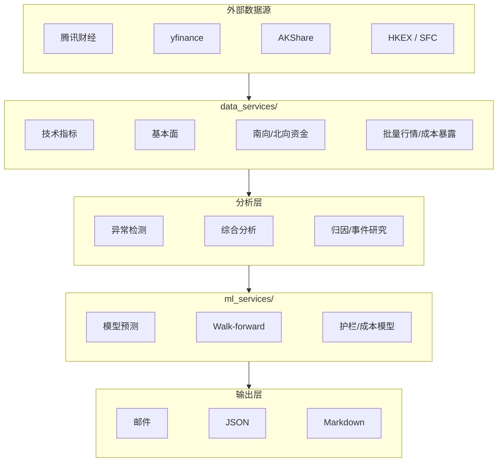

#  金融资产智能分析与诊断系统

**人机混合智能**的金融量化研究与工程框架：整合**大模型分析**与**机器学习预测**，覆盖**港股 / A股**，并提供**验证、诊断、个股分析**三类通用能力。

> ### 一句话
> 这是一个**能跑、能解释、能被第三方复核**的研究平台，五项能力权重相同：
> **① 港股预测 ② A股预测 ③ 假设验证 ④ 市场诊断 ⑤ 个股基本面分析**。
> 每项能力都写明**输入 / 输出 / 适用边界**；预测类不承诺收益，诊断/分析类不替代投资决策。

## 🗺 目录

| 部分 | 章节 |
|---|---|
| **一 · 能做什么** | [1 能力总览](#1-能力总览) · [2 五大能力](#2-五大能力) |
| **二 · 怎么用** | [3 快速开始](#3-快速开始) · [4 系统构成](#4-系统构成) |
| **三 · 怎么运转** | [5 通用机制](#5-通用机制验证--口径--成本) · [6 技术架构](#6-技术架构) · [7 自动化调度](#7-自动化调度) · [8 命令参考](#8-命令参考) · [9 配置](#9-配置与环境变量) |
| **四 · 边界与参考** | [10 适用边界](#10-适用边界) · [11 文档索引](#11-文档索引) · [12 依赖与许可](#12-依赖--许可--联系) |

---

# 第一部分 · 能做什么

## 1. 能力总览

| # | 能力 | 输入 | 输出 | 定位 |
|---|---|---|---|---|
| ① | 🇭🇰 **港股预测** | 310 只训练池 + 30 只自选 | 恒指/个股 5·10·20d 分数、异常、报告 | 生产/研究系统 |
| ② | 🇨🇳 **A股预测** | 53 只股票池 | 三周期预测、综合建议、板块 | 生产/研究系统 |
| ③ | 🧾 **假设验证** | 任意策略/因子/参数 | 过/不过、MDE、适用边界 | 项目最可信的资产 |
| ④ | 🔎 **市场诊断** | 指数、个股、公告、成本参数 | 收益归因、成本校准、事件研究 | 通用分析能力 |
| ⑤ | 📄 **个股分析** | 三表 + 价格 + 股息 | 财务质量、红旗、估值、情景 | 通用分析能力 |

> 三类产品性质不同：**预测**给分数，**验证**判断分数可不可信，**诊断/分析**解释分数或收益从哪来。
> 五者共用同一套数据与口径，但不能互相替代，也不能把后三者的结论当交易信号。

---

## 2. 五大能力

### 2.1 🇭🇰 港股预测系统

**做什么**
- 恒生指数 5/10/20 日方向；
- 30 只自选股的 5/10/20 日横截面强弱分位；
- 异常检测（Z-Score + Isolation Forest）。

**关键口径**
- 训练池 310 只、预测池 30 只；LightGBM + rank 标签；
- 5d/20d 默认 3-seed bagging，10d 单 seed；模型月度重训、日常只加载；
- 市场情绪按训练池广度分层（批量行情，约 7 个请求）。

**适用边界**：研究 / 展示 / 风控；信号经 PIT Walk-forward 与三道闸验证，不承诺收益。

**入口**
```bash
python3 hsi_prediction.py --no-email
./scripts/run_comprehensive_analysis.sh
```

### 2.2 🇨🇳 A股预测系统

**做什么**
- 个股 5/10/20 日预测；
- 综合买卖建议 + 板块分析；
- 核心 4 只 + 扩展 49 只的股票池。

**关键口径**
- LightGBM；核心股样本权重 3.0；
- 腾讯 A 股接口**恒返回 640 行（≈2.5 年）**，可用测试期不足 2 年；
- 涨跌停 10%/20% 需标签标准化，代码保存 `zfill(6)`。

**适用边界**：受数据硬限，结论功效不足；定位研究/展示，不升配。

**入口**
```bash
./scripts/run_a_stock_analysis.sh
python3 a_stock_walk_forward.py --horizon 20
```

### 2.3 🧾 假设验证框架

**做什么**
- 任何「策略 / 因子 / 参数 / 换池 / 换周期」命题的标准化验证；
- 预注册判据 → ⓪ 同一性 → 数据卫生 → 口径 → A/B/C 三闸 → 稳健性 → MDE → 记录。

**关键口径**
- A 闸：泄漏检查（`presentation_gate.py`，非零退出即阻断）；
- B 闸：PBO 对零假设带 + DSR ≥ 0.95；
- C 闸：超额净 IR 的 95%CI 下界 > 0；
- 结论必须带**适用范围**与 **MDE**（「不显著」≠「没有」）。

**适用边界**：它不生产 alpha，只保证不自欺；所有预测/诊断结论都要先过它。

**入口**
- 技能：[.opencode/skills/hypothesis-validation/SKILL.md](.opencode/skills/hypothesis-validation/SKILL.md)
- 台账：[docs/DECISIONS.md](docs/DECISIONS.md) / [lessons.md](lessons.md)

### 2.4 🔎 市场诊断与归因

**做什么**
- 指数 vs 个股：把「跑赢/跑输」拆成**股息、端点、权重、幸存者**；
- IC 归因：按流动性 / Beta / 行业分层；
- 成本校准：按 ADV / 佣金 / 价差 / 冲击；
- 事件研究：盈警、配售、供股、卖空；
- 跨快照 / 跨窗口稳健性。

**关键口径**
- 股票用前复权，指数必须用**含息基准**（如 2800.HK）；
- 回填历史必须标注**幸存者偏差**（当前池 ≠ 当时池）；
- 至少报「等权 / 市值加权 / 含息」三套并标注端点。

**示例（2016-10 → 2026-10）**：恒指价格 +5.0%，含息 +43.8%；310 当前池中位 +2.1%。

**入口**
- 技能：[.opencode/skills/market-diagnostics/SKILL.md](.opencode/skills/market-diagnostics/SKILL.md)

```bash
python3 scripts/ic_attribution.py --input output/<run>/prediction_analysis.csv --horizon 20
python3 scripts/cost_calibration.py --pred output/<run>/prediction_analysis.csv
python3 scripts/hkex_event_study.py --horizon 20
```

### 2.5 📄 个股基本面分析

**做什么**
- 生意与护城河、财务质量、财报红旗；
- 相对估值 + 绝对估值三情景；
- 长期收益拆解、建仓方式（DCA vs 一次性）、风险清单；
- 金融股附录：NIM、成本收入、信用成本、PB-ROE、合理 PB。

**关键口径**
- 必算：营收/净利增速、毛利率、净利率、ROE/ROA、资产负债率、**OCF÷净利**；
- 估值：PE/PB/PS/FCF yield + DCF/DDM 三情景 + 反向 DCF；
- 金融股：NPL / 拨备覆盖率 / CET1 必须看年报（三表没有）。

**适用边界**：输出是**条件化分析**（含数据缺口），不构成个性化买卖建议。

**入口**
- 技能：[.opencode/skills/equity-analysis/SKILL.md](.opencode/skills/equity-analysis/SKILL.md)
- 脚本：`scripts/stock_fundamentals.py`

```bash
python3 scripts/stock_fundamentals.py --codes 0700.HK,0939.HK --ccy CNY
python3 scripts/stock_fundamentals.py --codes 0939.HK,1398.HK --bank --ccy CNY
```

---

# 第二部分 · 怎么用

## 3. 快速开始

### 3.1 安装

```bash
git clone https://github.com/wonglaitung/fortune.git
cd fortune
pip install -r requirements.txt
cp set_key.sh.sample set_key.sh   # 填邮箱与 API 密钥后 source set_key.sh
```

### 3.2 验证安装

```bash
python hsi_email.py --no-email
```

### 3.3 五项能力各跑一次

```bash
# ① 港股预测
python3 hsi_prediction.py --no-email
./scripts/run_comprehensive_analysis.sh

# ② A股预测
./scripts/run_a_stock_analysis.sh

# ③ 验证（对任意回测产物）
python3 scripts/presentation_gate.py --input output/<run>/prediction_analysis.csv --horizon 20
python3 ml_services/monthly_guardrail.py --horizon 20 --pred output/<run>/prediction_analysis.csv

# ④ 市场诊断
python3 scripts/ic_attribution.py --input output/<run>/prediction_analysis.csv --horizon 20
python3 scripts/cost_calibration.py --pred output/<run>/prediction_analysis.csv

# ⑤ 个股分析
python3 scripts/stock_fundamentals.py --codes 0700.HK,0939.HK --ccy CNY
```

---

## 4. 系统构成

### 4.1 双市场一览

| | 🇭🇰 港股 | 🇨🇳 A股 |
|---|---|---|
| **预测池** | **30 只自选股** | 53 只（4 核心 + 49 扩展） |
| **训练池** | **310 只**（300 冻结池 ∪ 原 49 池） | 53 只 |
| 预测内容 | 恒指三周期 + 个股三周期 + 异常检测 | 个股三周期 + 综合建议 + 板块 |
| 指数预测 | ✅ 恒指 5/10/20d | ❌ |
| 市场特有 | 南向资金、CCASS、SFC 卖空 | 北向资金、涨跌停特征 |
| 模型 | LightGBM（rank；5/20d 3-seed bagging） | LightGBM |
| 特征量 | ~1400 → Top500 + FORCE | ~1077 |
| 数据硬限 | — | **腾讯源 640 行（≈2.5 年）** |
| 自动化 | 工作日 16:30 HKT | 本地 15:15 CST；CI 周日 |

> **标签口径**：个股（港股 + A股）为横截面百分位 rank 回归，周期 **5 / 10 / 20 天**；
> 输出语义是「池内相对强弱分位」。恒指 / 异常检测是方向任务，不用 rank 标签。
> **打分口径**：生产选股 = raw prob（保留板块间信息），无行业中性、无开关。

### 4.2 训练池与预测池（港股）

```
训练池 310 只 = data/hk_broad/universe_310.json（300 冻结池 ∪ 原 49 池）
      │  LightGBM 5/10/20d 训练（rank；5/20d 3-seed bagging）
      ▼
模型 pkl（data/ml_trading_model_lgbm_{5,10,20}d.pkl + *.manifest.json）
      │  参数：data/lgbm_best_params.json（生产与 WF 同源）
      │  逐只推理（30 只）
      ▼
预测池 30 只 = config.WATCHLIST
```

- 训练池是生产依赖，已入库；缺失时 `config` 直接报错。
- **模型月级更新**：日常只加载 pkl；`scripts/monthly_retrain.sh` 每月 1 日重训（D82）。

### 4.3 缓存

| 市场 | 缓存 | 位置 | 有效期 |
|---|---|---|---|
| 🇭🇰 | 原始数据 / 特征 | `data/stock_cache/` `data/feature_cache/` | 7 天 |
| 🇨🇳 | 原始数据 / 特征 | `data/a_stock_cache/` `data/a_stock_feature_cache/` | 7 天 |

> 改特征后必须清缓存，否则旧特征静默复用（命令见 [8](#8-命令参考)）。

---

# 第三部分 · 怎么运转

## 5. 通用机制（验证 / 口径 / 成本）

### 5.1 八步工作流（任何结论都走一遍）

```
① 命题预登记 ──► ② ⓪同一性闸 ──► ③ 数据卫生 ──► ④ 口径对齐
   (写死判据)      (WF=生产?)       (非空/无穿越)    (标签/成本/时点)
        │
        ▼
⑤ 三道闸 ──► ⑥ 稳健性 ──► ⑦ 功效/MDE ──► ⑧ 记录与适用范围
 A泄漏/B过拟合  相邻参数/独立窗   不显著≠没有      D 编号 + lessons
```

### 5.2 三道闸

| 闸 | 卡什么 | 工具 |
|---|---|---|
| **A 泄漏** | 准确率异常、概率饱和、符号退化 | `scripts/presentation_gate.py`（H1–H6，非零退出即阻断） |
| **B 过拟合** | 参数一挑就漂亮 | PBO 对零假设带 + DSR ≥ 0.95 |
| **C 净超额** | 毛正净负 | 超额净 IR 的 95%CI 下界 > 0 |

### 5.3 成本口径

- 一律用**往返**：`COST_ROUND_TRIP = 0.5%`（单边 0.25%）；
- 持仓替换：`成本 = 单边换手 × 往返`；仓位变化：`0.5 × Σabs(Δw) × 往返`；
- 可选分层模型：`--cost-mode model`（按 ADV / 佣金 / 价差 / 冲击）；
- 生产 30 只实测隐含约 0.58%，310 池约 1.02%（D99）。

### 5.4 可复核机制

| 机制 | 做法 |
|---|---|
| **三冻结** | 宏观快照 + 个股行情快照 + 门槛基准 CSV |
| **双跑验收** | 同配置连跑两次，`prediction_analysis.csv` md5 相同 |
| **同一性** | 社区集合 / 列集合 / 时点 / 概率来源四问 |
| **模型清单** | 每个 pkl 带 `*.manifest.json`（sha256 / 参数 / bag / 特征数 / 训练时间） |

---

## 6. 技术架构

### 6.1 数据流



| 模块 | 港股 | A股 |
|---|---|---|
| 数据获取 | yfinance + 腾讯财经 | AKShare + 腾讯财经 |
| 市场资金 | 南向资金 | 北向资金 |
| 核心模型 | `ml_services/ml_trading_model.py` | `a_stock_ml_model.py` |
| 综合分析 | `comprehensive_analysis.py` | `a_stock_comprehensive_analysis.py` |
| 大模型建议 | `comprehensive_analysis.py` 集成 | `a_stock_email.py` |

---

## 7. 自动化调度

| 时间 | 工作流 | 功能 | 市场 |
|---|---|---|---|
| 06:00（工作日） | `hsi-prediction.yml` | 恒生指数预测 | 🇭🇰 |
| 06:00（工作日） | `batch-stock-news-fetcher.yml` | 批量个股新闻 | 🇭🇰 |
| 每小时 | `hourly-crypto-monitor.yml` / `hourly-gold-monitor.yml` | 加密 / 黄金监控 | 🌐 |
| 16:30 HKT（工作日） | `comprehensive-analysis.yml` | 港股综合分析（只加载模型） | 🇭🇰 |
| 00:00 HKT（工作日） | `performance-monitor.yml` | 性能报告 | 🇭🇰 |
| 周日 09:00 HKT | `weekly-comprehensive-analysis.yml` | 港股周度分析 | 🇭🇰 |
| 周日 11:00 CST | `weekly-a-stock-comprehensive-analysis.yml` | A股周度分析 | 🇨🇳 |
| 每月 1 日 18:00 HKT | `monthly-retrain.yml` | 港股 5/10/20d 重训 + 提交模型 | 🇭🇰 |
| 每交易日 20:00 HKT | `ccass-archive.yml` | CCASS 日归档（私有数据仓） | 🇭🇰 |

> 严格护栏（`monthly_guardrail.py`）需本地 `prediction_analysis.csv`，见 [docs/DEPLOYMENT.md](docs/DEPLOYMENT.md)。

---

## 8. 命令参考

```bash
# ① 港股
python3 hsi_prediction.py --no-email
python3 comprehensive_analysis.py
./scripts/run_comprehensive_analysis.sh
python3 detect_stock_anomalies.py --mode standalone --mode-type deep
python3 ml_services/ml_trading_model.py --mode train --horizon 20 --model-type lgbm --use-feature-selection
python3 ml_services/ml_trading_model.py --mode predict --horizon 20 --model-type lgbm --use-feature-selection
python3 ml_services/walk_forward_validation.py --model-type lgbm --horizon 20 --use-feature-selection
bash scripts/monthly_retrain.sh
bash scripts/run_ccass_archive.sh

# ② A股
./scripts/run_a_stock_analysis.sh
python3 a_stock_ml_model.py --mode train --horizon 20
python3 a_stock_ml_model.py --mode predict --horizon 20 --core-only
python3 a_stock_walk_forward.py --horizon 20

# ③ 验证 / 护栏
python3 scripts/presentation_gate.py --input output/<run>/prediction_analysis.csv --horizon 20
python3 ml_services/monthly_guardrail.py --horizon 20 --pred output/<run>/prediction_analysis.csv
python3 ml_services/monthly_guardrail.py --horizon 20 --pred output/<run>/prediction_analysis.csv --sensitivity
python3 ml_services/portfolio_backtest.py --horizon 20 --topk 10 --pred output/<run>/prediction_analysis.csv
python3 ml_services/portfolio_backtest.py --horizon 20 --topk 10 --cost-mode model --pred output/<run>/prediction_analysis.csv

# ④ 诊断 / 归因
python3 scripts/ic_attribution.py --input output/<run>/prediction_analysis.csv --horizon 20 --write-subsets
python3 scripts/cost_calibration.py --pred output/<run>/prediction_analysis.csv
python3 scripts/hkex_event_study.py --horizon 20
python3 scripts/sfc_signal.py --fwd 20 --lag 10
python3 scripts/vintage_sensitivity.py --horizon 20 --topk 10

# ⑤ 个股分析
python3 scripts/stock_fundamentals.py --codes 0700.HK,0939.HK --ccy CNY
python3 scripts/stock_fundamentals.py --codes 0939.HK,1398.HK --bank --ccy CNY
python3 scripts/dca_eval.py --code 0700.HK --start 2016-10-17 --end 2026-10-16   # 定投 vs 一次性（IRR）
python3 scripts/dca_eval.py --code 0005.HK --start 2016-10-17 --end 2026-10-16 --total-return   # 总回报（股息再投资）

# 共用
python3 ml_services/performance_monitor.py --mode all --no-email
python3 ml_services/stock_network_analysis.py --skip-pmfg
python3 scripts/doc_gate.py

# 缓存清理（改特征后必做）
rm -rf data/feature_cache/*.pkl
rm -rf data/stock_cache/*.pkl
rm -rf data/a_stock_feature_cache/*.pkl
rm -rf data/a_stock_cache/*.pkl
```

> **复现基线**：先做三冻结（宏观快照 / 个股行情快照 / 门槛基准 CSV），再验收双跑 md5 一致。
> 完整口径见 [AGENTS.md](AGENTS.md) 与 [docs/BASELINES.md](docs/BASELINES.md)。

---

## 9. 配置与环境变量

| 变量名 | 说明 |
|---|---|
| `SMTP_SERVER` / `EMAIL_SENDER` / `EMAIL_PASSWORD` / `RECIPIENT_EMAIL` | 邮件 |
| `QWEN_API_KEY`（+ `QWEN_CHAT_URL` / `QWEN_CHAT_MODEL`） | LLM 密钥（opencode zen） |
| `CCASS_DATA_REPO` / `CCASS_DATA_TOKEN` | CCASS 归档的私有数据仓与 PAT |

> 完整环境变量、特征开关（`F1_FEATURES` / `HIBOR_FEATURES` 等）与调度细节见 [docs/ARCHITECTURE.md](docs/ARCHITECTURE.md)。

---

# 第四部分 · 边界与参考

## 10. 适用边界

**预测能力（①/②）**
- 已系统测过大市 / 板块 / 个股差异 / 风格 / 关联题材等层，**尚未发现可交易 edge**；
  口径是「未发现（不显著）」，不等于「已证明没有」（本宇宙 MDE ≈ 1.5 IR）。
- 定位：研究 / 展示 / 风控，不作为收益承诺。

**验证 / 诊断 / 个股分析（③/④/⑤）**
- 不预测收益，只负责把指标/收益拆解到可复核的口径；
- 诊断受数据缺口限制：无历史股数/权重、无退市股、无 2010–2023 PIT 成分；
- 个股分析缺分部数据、一致预期；金融股缺 NPL/拨备/CET1（需年报）。

| 警告 | 说明 |
|---|---|
| **数据泄漏** | WF 准确率 >65%（个股）或 >80%（恒指）通常是泄漏 |
| **预测阈值** | 方向判断用 **0.5**（rank 口径 = 池内中位数） |
| **周期集合** | 仅 **5 / 10 / 20 天** |
| **IC 口径** | 只认部署口径（逐日 + raw prob）；行级 z 是伪显著，须折聚类 |
| **绝对值 IR** | 含 beta；判断能力看**超额** |
| **成本** | 往返 0.5%（单边 0.25%）；分层模型见 `--cost-mode model` |
| **状态持续时间** | HMM `Regime_Duration` 不可预测（AUC ≈ 0.48），只作描述 |
| **时点口径** | 全链路 `mode='production'`（T 收盘，T+1 成交） |
| **深度学习** | LSTM / Transformer F1≈0，不推荐 |
| **A股特殊** | 涨跌停 10%/20%；代码 `zfill(6)`；核心股权重 3.0 |
| **特征缓存** | 改特征后不清缓存会静默复用旧值 |

---

## 11. 文档索引

| 想知道什么 | 看哪份 |
|---|---|
| **所有 Walk-forward 实测数字** | [docs/BASELINES.md](docs/BASELINES.md)（唯一真相源） |
| **⓪ 同一性闸 / 三道闸 / 硬约束** | [docs/REVIEW_GATES.md](docs/REVIEW_GATES.md) ⭐ |
| **决策与负结果台账** | [docs/DECISIONS.md](docs/DECISIONS.md) |
| **经验教训（因果链）** | [lessons.md](lessons.md) |
| **进度** | [progress.txt](progress.txt) |
| **会话规则 / 常用命令** | [AGENTS.md](AGENTS.md) |
| **文档导航** | [docs/README.md](docs/README.md) |
| **建设方法论** | [docs/QUANT_SYSTEM_METHODOLOGY.md](docs/QUANT_SYSTEM_METHODOLOGY.md) |
| **实盘部署与护栏** | [docs/DEPLOYMENT.md](docs/DEPLOYMENT.md) |
| **A股设计** | [docs/A_STOCK_DESIGN.md](docs/A_STOCK_DESIGN.md) |
| **三周期分析** | [docs/THREE_HORIZON_ANALYSIS.md](docs/THREE_HORIZON_ANALYSIS.md) |
| **特征工程** | [docs/FEATURE_ENGINEERING.md](docs/FEATURE_ENGINEERING.md) |
| **验证方法** | [docs/VALIDATION_GUIDE.md](docs/VALIDATION_GUIDE.md) |
| **个股分析技能** | [.opencode/skills/equity-analysis/SKILL.md](.opencode/skills/equity-analysis/SKILL.md) |
| **量化常见误区** | [docs/量化交易误解-正式文档.md](docs/量化交易误解-正式文档.md) |
| **编程规范** | [docs/programmer_skill.md](docs/programmer_skill.md) |

---

## 12. 依赖 · 许可 · 联系

**依赖**：`yfinance` `lightgbm` `akshare` `pandas` `scikit-learn` `requests` `beautifulsoup4` `lxml` `jieba` `hmmlearn` `arch` `networkx`

**许可**：MIT License（CCASS 原始数据仅本地，不入库、不再分发）

**联系**：
- Issues: https://github.com/wonglaitung/fortune/issues
- Email: wonglaitung@gmail.com
