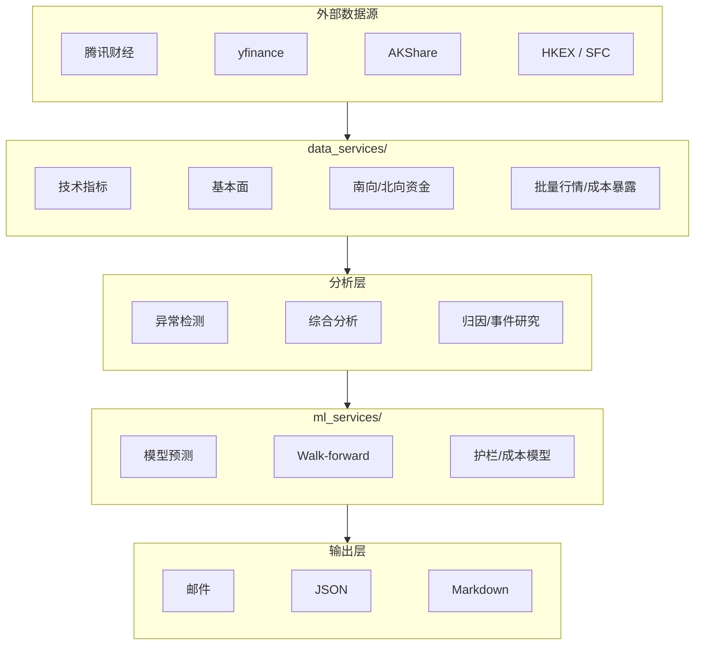

#  金融资产智能分析与诊断系统

**人机混合智能**的金融量化研究与工程框架：整合**大模型分析**与**机器学习预测**，覆盖**港股 / A股**，并提供一套可复核的**市场诊断与归因**工具。

> ### 一句话
> 这是一个**能跑、能解释、能被第三方复核**的研究平台：
> ① 港股预测 ② A股预测 ③ 假设验证框架（尺子） ④ **市场诊断与归因**。
> 预测信号经过 PIT Walk-forward、三道闸与成本校准，**适用边界被明确标注**；
> 诊断工具则用于回答「这个跑赢/跑输是真的吗、来自哪里」。

## 🗺 目录

| 部分 | 章节 |
|---|---|
| **一 · 能做什么** | [1 功能总览](#1-功能总览) · [2 市场诊断与归因（重点能力）](#2-市场诊断与归因重点能力) |
| **二 · 怎么用** | [3 快速开始](#3-快速开始) · [4 系统构成](#4-系统构成) |
| **三 · 怎么运转** | [5 验证框架](#5-验证框架) · [6 技术架构](#6-技术架构) · [7 自动化调度](#7-自动化调度) · [8 命令参考](#8-命令参考) · [9 配置](#9-配置与环境变量) |
| **四 · 边界与参考** | [10 适用边界](#10-适用边界) · [11 文档索引](#11-文档索引) · [12 依赖与许可](#12-依赖--许可--联系) |

---

# 第一部分 · 能做什么

## 1. 功能总览

| # | 能力 | 内容 | 定位 |
|---|---|---|---|
| ① | 🇭🇰 **港股预测系统** | 恒指三周期 + 30 只自选股三周期 + 异常检测 | 可运行的生产/研究系统 |
| ② | 🇨🇳 **A股预测系统** | 三周期 + 综合买卖建议 + 板块分析 | 可运行；受数据源 640 行硬限 |
| ③ | 🧾 **假设验证框架** | 预注册 / ⓪ 同一性 / A·B·C 三闸 / 折聚类 / MDE | **项目最可信的资产** |
| ④ | 🔎 **市场诊断与归因** | 指数 vs 个股分解、流动性/Beta/行业归因、成本校准、事件研究、幸存者检查 | 新增的**通用分析能力** |

**外围辅助**：crypto / 黄金监控、性能监控、新闻抓取、SFC / 南向 / CCASS 取数。

> 预测与诊断是两类不同产品：**预测**回答「模型给了什么分」，**诊断**回答「这个分数/收益可不可信、来自哪里」。
> 两者共用同一套数据与口径，但请勿把诊断结论当作交易信号。

---

## 2. 市场诊断与归因（重点能力）

这套工具原本是为验证 alpha 建的，后来发现它同样能回答「市场到底发生了什么」。

### 2.1 能回答的问题

| 问题 | 工具 | 输出 |
|---|---|---|
| 「某只股票跑赢指数，是真的吗？」 | 含息基准 + 端点 + 权重 + 幸存者分解 | 超额收益的真实来源 |
| 「IC 很高为什么不赚钱？」 | `scripts/ic_attribution.py` | 按流动性 / Beta / 行业的逐日 IC 与净收益 |
| 「交易成本到底多少？」 | `scripts/cost_calibration.py` + `--cost-mode model` | 按 ADV / 佣金档 / 单笔金额的往返成本 |
| 「某个事件有没有漂移？」 | `scripts/hkex_event_study.py` / `scripts/sfc_signal.py` | 事件后 N 日 CAR + 聚类 t |
| 「参数/池子换了还成立吗？」 | `scripts/vintage_sensitivity.py` + 独立窗口 | 跨快照 / 跨窗口复现性 |

### 2.2 示例：十年恒指「原地踏步」的真假

以 2016-10 → 2026-10 的实测为例（工具可复跑）：

| 拆解 | 数字 | 含义 |
|---|---|---|
| 恒指**价格** | 23,038 → 24,187（**+5.0%**） | 十年几乎平 |
| 2800.HK **含息** | **+43.8%** | 价格指数漏掉的股息约 **38.8pp** |
| 2018 峰 → 2022 谷 | **−55.7%** | 十年里有一次腰斩级回撤 |
| 310 只当前池中位 | **+2.1%** | 中位数公司本来就平/负 |
| 自选 30 等权 | +203.7% | 但这是**事后挑选的赢家子集**（幸存者+选择偏差） |

⇒ 同一段历史，**换基准、换端点、换权重、换池子**可以得出完全不同的结论。
诊断工具的作用就是把这些口径逐项拆开，而不是讲一个好听的故事。

### 2.3 三条使用原则

1. **含息优先**：股票用前复权，指数必须用含息基准（2800.HK / 总收益指数），否则高估股票约 3–4%/年。
2. **同期同池**：回填历史必须用 PIT 成分与退市股；拿今天的名单回填十年，只能当描述性统计。
3. **多端点 + 多权重**：至少报「等权 / 市值加权 / 含息」三套，并标注端点敏感性。

### 2.4 数据基础：靠什么做诊断

诊断不依赖付费数据，全部来自项目已归档/可再取的本地数据；这也决定了它能回答什么、不能回答什么。

| 数据 | 覆盖 / 粒度 | 位置 | 支撑的诊断 |
|---|---|---|---|
| 个股 OHLCV（前复权） | 310 只，2006 → 2026 | `data/hk_broad/snapshot/` | 收益、ADV、波动、Beta、tick 价差 |
| 恒指价格 | 2016 → 2026（本地缓存） | `HSI.pkl` | 指数收益 / 回撤 / 端点 |
| 2800.HK（含息调整） | 2009 → | yfinance | 总收益基准（股息差） |
| 板块映射 | 310 只 | `config.STOCK_SECTOR_MAPPING` | 行业归因 / 中性化 |
| 成本参数 | 佣金 / 印花税 / 最低费 / tick | `ml_services/costs.py` | 分层成本、盈亏平衡 |
| HKEX 公告 | 2010 →，按股按年 | `data/hkex_announcements/`（本地） | 事件研究（盈警 / 配售 / 供股） |
| SFC 卖空 | 周频，2012 → | `data/sfc_short/` | 空头强度 / 事件 |
| 南向资金 | 日频**总量**，2014 → | `data/southbound_cache/` | 市场级资金（非个股） |
| CCASS | 日频，约 12 个月滚动 | `data/ccass/`（本地，不入库） | 总股本 / 市值、持股集中度（前向） |
| PIT 恒指成分 | 2023-07 → | `data/hsi_constituents_pit.csv` | 成分变化 / 事件（样本有限） |
| F1 基本面 | PIT 滞后 120 / 90 天 | `data/fund_cache/` | 质量 / 价值特征 |
| AH 溢价 | 13 对，2006 → | `data/ah_premium/` | 跨市场定价 |
| 美股 / 利率 / HIBOR | 2015-12 →（快照） | `data/us_market_snapshot/` | 宏观环境 |

**关键缺口（决定诊断的边界）**

| 缺口 | 后果 |
|---|---|
| 无历史股数 / 市值 | 只能算等权/价格加权，**无法做真正的市值加权基准或规模因子**（CCASS 只有当前） |
| 无历史 HSI 权重 | 无法把十年指数收益逐股分解贡献，只能比较成分收益与指数 |
| 无退市股 | **幸存者偏差无法修正**，只能标注 |
| 无 2010–2023 的 PIT 全市场成分 | 无法重建「当时真实池子」 |
| 南向只有总量 | 不能做个股横截面资金流 |

⇒ 因此本文的十年对比属于**描述性诊断**，不是「无偏回测」；要升级为无偏回测，需补：历史股数/权重、退市股、PIT 成分。

---

# 第二部分 · 怎么用

## 3. 快速开始

### 3.1 安装

```bash
git clone https://github.com/wonglaitung/fortune.git
cd fortune
pip install -r requirements.txt
cp set_key.sh.sample set_key.sh   # 填邮箱与 API 密钥后 source set_key.sh
```

### 3.2 验证安装

```bash
python hsi_email.py --no-email
```

### 3.3 跑一次

```bash
python3 hsi_prediction.py --no-email            # 港股：恒指三周期
./scripts/run_comprehensive_analysis.sh         # 港股：综合分析（默认只加载模型）
./scripts/run_a_stock_analysis.sh               # A股：完整流程

# 诊断示例
python3 scripts/ic_attribution.py --input output/<run>/prediction_analysis.csv --horizon 20
python3 scripts/cost_calibration.py --pred output/<run>/prediction_analysis.csv
```

---

## 4. 系统构成

### 4.1 双市场一览

| | 🇭🇰 港股 | 🇨🇳 A股 |
|---|---|---|
| **预测池** | **30 只自选股** | 53 只（4 核心 + 49 扩展） |
| **训练池** | **310 只**（300 冻结池 ∪ 原 49 池） | 53 只 |
| 预测内容 | 恒指三周期 + 个股三周期 + 异常检测（5/10/20d） | 个股三周期（5/10/20d）+ 综合买卖建议 + 板块 |
| 指数预测 | ✅ 恒指 5/10/20d | ❌ |
| 市场特有 | 南向资金、CCASS、SFC 卖空 | 北向资金、涨跌停特征 |
| 模型 | LightGBM（5/10/20d；rank 标签） | LightGBM |
| 特征量 | ~1400 → 选择 Top500 + FORCE | ~1077 |
| 数据硬限 | — | **腾讯源恒返回 640 行（≈2.5 年）** |
| 自动化 | 工作日 16:30 HKT | 本地 15:15 CST；CI 周日 |

> **标签口径**：个股（港股 + A股）为 **横截面百分位 rank 回归**，周期 **5 / 10 / 20 天**；
> 输出语义是「池内相对强弱分位」。**恒指 / 异常检测**是方向任务，不用 rank 标签。
> **打分口径**：生产选股 = **raw prob**（保留板块间信息）；**无行业中性、无开关**。

### 4.2 共同机制

- **市场情绪过滤器**：按滞后 1 天的上涨比例分层（extreme_bear <20% / bear / weak / normal）。
  日常用批量行情计算（约 7 个请求覆盖 310 只），不逐只拉历史。
- **市场状态稳定性**：HMM `Regime_Duration`（<5 天不稳定；5–15 中等；>15 稳定）。仅作描述。
- **评估口径**：一律基准扣除后的指标——方向技能 / 超额 lift / 逐年 / **折聚类**显著 / **逐日 mark** / 静态对照。
- **成本口径**：往返 `COST_ROUND_TRIP=0.5%`（单边 0.25%）；可选 `--cost-mode model`
  按 ADV / 佣金 / 价差 / 冲击分层（生产 30 实测隐含约 0.58%，310 池约 1.02%）。

### 4.3 其它模块

- **异常检测**：Z-Score + Isolation Forest；「异常 + 当日下跌 → 抄底」（z ≤ −3）在**大盘上行期**战术参考。
- **大模型分析**：经 OpenAI 兼容端点做「解释 / 上下文」，不作 alpha。
- **风险回报 / 模拟交易**：辅助工具（仓位 / 止损 / 日志），非预测信号。

---

# 第三部分 · 怎么运转

## 5. 验证框架

> 真正的产出不是「预测」，而是一台能可靠回答「这个策略行不行」的装置：**它不生产 alpha，它保证不自欺。**

### 5.1 它卡住什么

| 失真 | 表现 | 怎么卡 |
|---|---|---|
| **泄漏** | 准确率异常高、概率饱和、符号退化 | A 闸：`presentation_gate.py` 非零退出即阻断（H1–H6） |
| **过拟合** | 参数一挑就漂亮 | B 闸：PBO 对零假设带 + DSR ≥ 0.95 |
| **多重检验** | 扫 N 格总有一格好 | 预注册 + 相邻参数一致性 + 独立窗口 + 多重比较惩罚 |
| **成本忽略** | 毛超额正、净超额负 | C 闸：超额净 IR 的 95%CI 下界 > 0 |

### 5.2 工作流（8 步）

```
① 命题预登记 ──► ② ⓪同一性闸 ──► ③ 数据卫生 ──► ④ 口径对齐
   (写死判据)      (WF=生产?)       (非空/无穿越)    (标签/成本/时点)
        │
        ▼
⑤ 三道闸 ──► ⑥ 稳健性 ──► ⑦ 功效/MDE ──► ⑧ 记录与适用范围
 A泄漏/B过拟合  相邻参数/独立窗   不显著≠没有      D 编号 + lessons
```

触发词：**验证 / 行不行 / 可不可信 / 换池 · 换周期 · 加特征 · 择时** ⇒ 走技能
[.opencode/skills/hypothesis-validation/SKILL.md](.opencode/skills/hypothesis-validation/SKILL.md)（G1–G9）。

### 5.3 制度化产出

- **决策台账**：[docs/DECISIONS.md](docs/DECISIONS.md) —— D1–D101，命题 / 预注册 / 结果 / 适用范围。
- **教训库**：[lessons.md](lessons.md) —— 按因果链记录，每条给判定式。
- **规程**：[docs/REVIEW_GATES.md](docs/REVIEW_GATES.md) —— ⓪ 四问 + A/B/C 三闸清单。
- **门禁**：[scripts/doc_gate.py](scripts/doc_gate.py) —— 断链 / 表格 / 结论条件化 / 入库规范。

### 5.4 可复核机制

| 机制 | 做法 |
|---|---|
| **三冻结** | 宏观快照 + 个股行情快照 + 门槛基准 CSV |
| **双跑验收** | 同配置连跑两次，`prediction_analysis.csv` md5 必须相同 |
| **同一性** | 社区集合 / 列集合 / 时点 / 概率来源四问 |
| **模型清单** | 每个 pkl 带 `*.manifest.json`（sha256 / 参数 / bag / 特征数 / 训练时间） |

---

## 6. 技术架构

### 6.1 数据流



| 模块 | 港股 | A股 |
|---|---|---|
| 数据获取 | yfinance + 腾讯财经 | AKShare + 腾讯财经 |
| 市场资金 | 南向资金 | 北向资金 |
| 价格限制 | 无涨跌停 | 主板 10% / 创业板 20% |
| 核心模型 | `ml_services/ml_trading_model.py` | `a_stock_ml_model.py` |
| 综合分析 | `comprehensive_analysis.py` | `a_stock_comprehensive_analysis.py` |
| 大模型建议 | `comprehensive_analysis.py` 集成 | `a_stock_email.py` |

### 6.2 训练池与预测池（港股）

```
训练池 310 只 = data/hk_broad/universe_310.json（300 冻结池 ∪ 原 49 池）
      │  LightGBM 5/10/20d 训练（rank 标签；5d/20d 默认 3-seed bagging）
      ▼
模型 pkl（data/ml_trading_model_lgbm_{5,10,20}d.pkl + *.manifest.json）
      │  参数：data/lgbm_best_params.json（生产与 WF 同源）
      │  逐只推理（30 只）
      ▼
预测池 30 只 = config.WATCHLIST
```

- 训练池文件是**生产依赖**，已入库；缺失时 `config` 直接报错。
- **模型月级更新**：日常只加载 pkl；`scripts/monthly_retrain.sh` 每月 1 日重训（D82）。
- 市场广度按训练池计算（批量行情）；预测只遍历 30 只自选。

### 6.3 缓存

| 市场 | 缓存 | 位置 | 有效期 |
|---|---|---|---|
| 🇭🇰 | 原始数据 / 特征 | `data/stock_cache/` `data/feature_cache/` | 7 天 |
| 🇨🇳 | 原始数据 / 特征 | `data/a_stock_cache/` `data/a_stock_feature_cache/` | 7 天 |

> 改特征后必须清缓存，否则旧特征静默复用（命令见 [8](#8-命令参考)）。

---

## 7. 自动化调度

| 时间 | 工作流 | 功能 | 市场 |
|---|---|---|---|
| 06:00（工作日） | `hsi-prediction.yml` | 恒生指数预测 | 🇭🇰 |
| 06:00（工作日） | `batch-stock-news-fetcher.yml` | 批量个股新闻 | 🇭🇰 |
| 每小时 | `hourly-crypto-monitor.yml` / `hourly-gold-monitor.yml` | 加密 / 黄金监控 | 🌐 |
| 16:30 HKT（工作日） | `comprehensive-analysis.yml` | 港股综合分析（只加载模型） | 🇭🇰 |
| 00:00 HKT（工作日） | `performance-monitor.yml` | 性能报告（lift / 方向技能 / 护栏） | 🇭🇰 |
| 周日 09:00 HKT | `weekly-comprehensive-analysis.yml` | 港股周度分析 | 🇭🇰 |
| 周日 11:00 CST | `weekly-a-stock-comprehensive-analysis.yml` | A股周度分析 | 🇨🇳 |
| 每月 1 日 18:00 HKT | `monthly-retrain.yml` | 港股 5/10/20d 重训 + 提交模型 | 🇭🇰 |
| 每交易日 20:00 HKT | `ccass-archive.yml` | CCASS 日归档（提交到私有数据仓） | 🇭🇰 |

> 严格护栏（`monthly_guardrail.py`）需本地 `prediction_analysis.csv`，见 [docs/DEPLOYMENT.md](docs/DEPLOYMENT.md)。

---

## 8. 命令参考

```bash
# ============ 🇭🇰 港股 ============
python3 hsi_prediction.py --no-email
python3 comprehensive_analysis.py
./scripts/run_comprehensive_analysis.sh
python3 detect_stock_anomalies.py --mode standalone --mode-type deep
python3 simulation_trader.py
python3 ml_services/ml_trading_model.py --mode train --horizon 20 --model-type lgbm --use-feature-selection
python3 ml_services/ml_trading_model.py --mode predict --horizon 20 --model-type lgbm --use-feature-selection
python3 ml_services/walk_forward_validation.py --model-type lgbm --horizon 20 --use-feature-selection
bash scripts/monthly_retrain.sh                     # 月度重训（5/10/20）
bash scripts/run_ccass_archive.sh                   # CCASS 日归档（本地）

# ============ 🇨🇳 A股 ============
./scripts/run_a_stock_analysis.sh
python3 a_stock_ml_model.py --mode train --horizon 20
python3 a_stock_ml_model.py --mode predict --horizon 20 --core-only
python3 a_stock_walk_forward.py --horizon 20
python3 a_stock_email.py --force --no-email

# ============ 验证 / 护栏 / 成本 ============
python3 scripts/presentation_gate.py --input output/<run>/prediction_analysis.csv --horizon 20
python3 ml_services/monthly_guardrail.py --horizon 20 --pred output/<run>/prediction_analysis.csv
python3 ml_services/monthly_guardrail.py --horizon 20 --pred output/<run>/prediction_analysis.csv --sensitivity
python3 ml_services/portfolio_backtest.py --horizon 20 --topk 10 --pred output/<run>/prediction_analysis.csv
python3 ml_services/portfolio_backtest.py --horizon 20 --topk 10 --cost-mode model --pred output/<run>/prediction_analysis.csv
python3 scripts/cost_calibration.py --pred output/<run>/prediction_analysis.csv

# ============ 诊断 / 归因 ============
python3 scripts/ic_attribution.py --input output/<run>/prediction_analysis.csv --horizon 20 --write-subsets
python3 scripts/hkex_event_study.py --horizon 20
python3 scripts/sfc_signal.py --fwd 20 --lag 10
python3 scripts/vintage_sensitivity.py --horizon 20 --topk 10

# ============ 共用工具 ============
python3 ml_services/performance_monitor.py --mode all --no-email
python3 ml_services/stock_network_analysis.py --skip-pmfg
python3 scripts/doc_gate.py

# ============ 缓存清理（改特征后必做） ============
rm -rf data/feature_cache/*.pkl
rm -rf data/stock_cache/*.pkl
rm -rf data/a_stock_feature_cache/*.pkl
rm -rf data/a_stock_cache/*.pkl
```

> **复现基线**：先做**三冻结**（宏观快照 / 个股行情快照 / 门槛基准 CSV），再验收双跑 md5 一致。
> 完整口径见 [AGENTS.md](AGENTS.md) 与 [docs/BASELINES.md](docs/BASELINES.md)。

---

## 9. 配置与环境变量

| 变量名 | 说明 |
|---|---|
| `SMTP_SERVER` / `EMAIL_SENDER` / `EMAIL_PASSWORD` / `RECIPIENT_EMAIL` | 邮件 |
| `QWEN_API_KEY`（+ `QWEN_CHAT_URL` / `QWEN_CHAT_MODEL`） | LLM 密钥（opencode zen） |
| `CCASS_DATA_REPO` / `CCASS_DATA_TOKEN` | CCASS 归档的私有数据仓与 PAT |

> 完整环境变量、特征开关（`F1_FEATURES` / `HIBOR_FEATURES` 等）与调度细节见 [docs/ARCHITECTURE.md](docs/ARCHITECTURE.md)。

---

# 第四部分 · 边界与参考

## 10. 适用边界

系统对「预测信号」的验证结论是**有限且条件化**的：

- 已系统测过大市 / 板块 / 个股差异 / 风格 / 关联题材等层，**尚未发现可交易 edge**；
  口径是「未发现（不显著）」，不等于「已证明没有」（本宇宙 MDE ≈ 1.5 IR）。
- 因此预测模块定位为 **研究 / 展示 / 风控**，不作为收益承诺。
- **诊断模块不受此限**：它不预测收益，只负责把收益/指标拆解到可复核的口径
  （含息、端点、权重、幸存者、成本），适用于任何标的与时段。

| 警告 | 说明 |
|---|---|
| **数据泄漏** | WF 准确率 >65%（个股）或 >80%（恒指）通常是泄漏；个股正常 50–60% |
| **预测阈值** | 方向判断用 **0.5**（rank 口径下 = 池内中位数） |
| **周期集合** | 仅 **5 / 10 / 20 天** |
| **IC 口径** | 只认部署口径（逐日 + raw prob）；行级 z 是伪显著，须折聚类 |
| **绝对值 IR** | 含 beta；判断能力看**超额**（减等权基准） |
| **成本** | 往返 0.5%（单边 0.25%）；分层模型见 `--cost-mode model` |
| **状态持续时间** | HMM `Regime_Duration` 不可预测（AUC ≈ 0.48），只作描述 |
| **时点口径** | 全链路 `mode='production'`（T 收盘，T+1 成交） |
| **深度学习** | LSTM / Transformer F1≈0，不推荐 |
| **A股特殊** | 涨跌停 10%/20%；代码 `zfill(6)`；核心股权重 3.0 |
| **特征缓存** | 改特征后不清缓存会静默复用旧值 |

---

## 11. 文档索引

| 想知道什么 | 看哪份 |
|---|---|
| **所有 Walk-forward 实测数字** | [docs/BASELINES.md](docs/BASELINES.md)（唯一真相源） |
| **⓪ 同一性闸 / 三道闸 / 硬约束** | [docs/REVIEW_GATES.md](docs/REVIEW_GATES.md) ⭐ |
| **决策与负结果台账** | [docs/DECISIONS.md](docs/DECISIONS.md) |
| **经验教训（因果链）** | [lessons.md](lessons.md) |
| **进度** | [progress.txt](progress.txt) |
| **会话规则 / 常用命令** | [AGENTS.md](AGENTS.md) |
| **文档导航** | [docs/README.md](docs/README.md) |
| **建设方法论** | [docs/QUANT_SYSTEM_METHODOLOGY.md](docs/QUANT_SYSTEM_METHODOLOGY.md) |
| **实盘部署与护栏** | [docs/DEPLOYMENT.md](docs/DEPLOYMENT.md) |
| **A股设计** | [docs/A_STOCK_DESIGN.md](docs/A_STOCK_DESIGN.md) |
| **三周期分析** | [docs/THREE_HORIZON_ANALYSIS.md](docs/THREE_HORIZON_ANALYSIS.md) |
| **特征工程** | [docs/FEATURE_ENGINEERING.md](docs/FEATURE_ENGINEERING.md) |
| **验证方法** | [docs/VALIDATION_GUIDE.md](docs/VALIDATION_GUIDE.md) |
| **量化常见误区** | [docs/量化交易误解-正式文档.md](docs/量化交易误解-正式文档.md) |
| **编程规范** | [docs/programmer_skill.md](docs/programmer_skill.md) |

---

## 12. 依赖 · 许可 · 联系

**依赖**：`yfinance` `lightgbm` `akshare` `pandas` `scikit-learn` `requests` `beautifulsoup4` `lxml` `jieba` `hmmlearn` `arch` `networkx`

**许可**：MIT License（CCASS 原始数据仅本地，不入库、不再分发）

**联系**：
- Issues: https://github.com/wonglaitung/fortune/issues
- Email: wonglaitung@gmail.com
