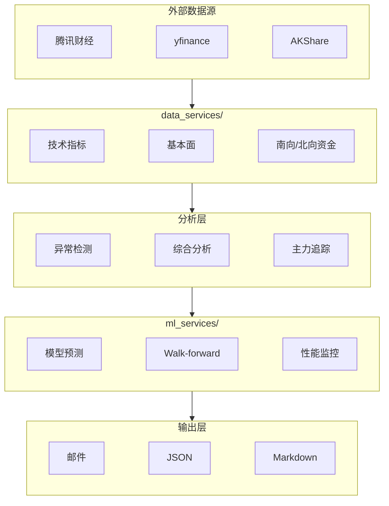
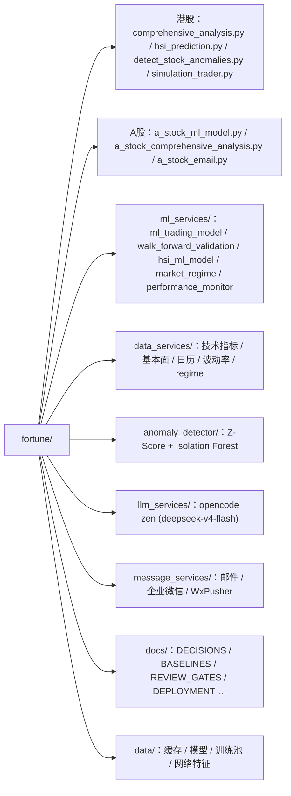

#  金融资产智能分析与交易系统

**⭐ 如果您觉得这个项目有用，请先给项目 Star 再 Fork，以支持项目发展！⭐**

**人机混合智能**的金融量化研究与工程框架：整合**大模型分析**与**机器学习预测**，覆盖**港股 / A股**。

> ### ⚠️ 当前结论（先读这段）
>
> 本项目**不是"能赚钱的策略"**。经 Walk-forward（PIT）、三道闸、逐日 mark、静态对照验证：
> **大市方向 / 板块轮动 / 个股差异 / 风格 / 关联题材，各层单独测过，均未发现可交易 edge。**
> 口径是「**未发现（不显著）**」，不等于「已证明没有」——本宇宙功效有限（MDE ≈ 1.5 IR）。
> 系统的价值在 **① 工程化  ② 展示 / 报告  ③ 风控  ④ 假设验证框架**；其中**最可信的资产是"验证框架（尺子）"**。

## 🗺 目录

| 部分 | 章节 |
|---|---|
| **一 · 能不能信** | [1 验证框架](#1-验证框架本项目最可信的资产) · [2 功能与定性](#2-功能与诚实定性) |
| **二 · 怎么用** | [3 快速开始](#3-快速开始) · [4 系统构成](#4-系统构成) |
| **三 · 怎么运转** | [5 技术架构](#5-技术架构) · [6 项目结构](#6-项目结构) · [7 自动化调度](#7-自动化调度) · [8 命令参考](#8-命令参考) · [9 配置](#9-配置与环境变量) |
| **四 · 边界与参考** | [10 核心警告](#10-核心警告) · [11 文档索引](#11-文档索引) · [12 依赖与许可](#12-依赖--许可--联系) |

---

# 第一部分 · 能不能信

## 1. 验证框架（本项目最可信的资产）

> 真正的产出不是"预测"，而是一台能可靠回答「这个策略行不行」的装置：**它不生产 alpha，它保证不自欺。**

### 1.1 它卡住什么

| 失真 | 表现 | 怎么卡 |
|---|---|---|
| **泄漏** | 准确率 80%、概率饱和 0/1、符号退化 | A 闸：`presentation_gate.py` 非零退出即阻断（H1–H6） |
| **过拟合** | 参数一挑就漂亮 | B 闸：PBO 对零假设带 + DSR ≥ 0.95 |
| **多重检验** | 扫 N 格总有一格好 | 预注册判据 + 相邻参数一致性 + 独立窗口 + 多重比较惩罚 |
| **成本忽略** | 毛超额正、净超额负 | C 闸：超额净 IR 的 95%CI 下界 > 0 |

### 1.2 工作流（8 步，缺一步不出结论）

```
① 命题预登记 ──► ② ⓪同一性闸 ──► ③ 数据卫生 ──► ④ 口径对齐
   (写死判据)      (WF=生产?)       (非空/无穿越)    (标签/成本/时点)
        │
        ▼
⑤ 三道闸 ──► ⑥ 稳健性 ──► ⑦ 功效/MDE ──► ⑧ 记录与适用范围
 A泄漏/B过拟合  相邻参数/独立窗   不显著≠没有      D 编号 + lessons
 C净超额CI
```

触发词：**验证 / 行不行 / 有没有 alpha / 可不可信 / 换池 · 换周期 · 加特征 · 择时**
⇒ 走技能 [.opencode/skills/hypothesis-validation/SKILL.md](.opencode/skills/hypothesis-validation/SKILL.md)（G1–G9 硬规则）。

### 1.3 制度化产出（可审计）

- **决策台账**：[docs/DECISIONS.md](docs/DECISIONS.md) —— D1–D73，每条含命题 / 预注册判据 / 数据窗口 / 结果 / 适用范围；判死即不复活。
- **教训库**：[lessons.md](lessons.md) —— 按因果链记录，每条给判定式（如「引用 IC 必须交代逐日/池化、原始/中性、t 的来源」）。
- **规程**：[docs/REVIEW_GATES.md](docs/REVIEW_GATES.md) —— ⓪ 同一性四问 + A/B/C 三闸 9 项清单。
- **门禁**：[scripts/doc_gate.py](scripts/doc_gate.py) —— 断链 / 表格 / 结论条件化 / 入库规范，不过即拒绝提交。

### 1.4 结论可被第三方复核

| 机制 | 做法 |
|---|---|
| **三冻结** | 宏观快照 + 个股行情快照 + 门槛基准 CSV，缺一不可 |
| **双跑验收** | 同配置连跑两次，`prediction_analysis.csv` md5 必须相同 |
| **同一性** | 社区集合 / 列集合 / 时点 / 概率来源四问，任一「否」即停 |
| **口径留痕** | 每个数字标注：WF 内部比较 ✓ / 外推生产 ✗ |

### 1.5 30 秒上手

```bash
python3 scripts/presentation_gate.py --input output/<run>/prediction_analysis.csv --horizon 20  # A 闸
python3 ml_services/monthly_guardrail.py --horizon 20 --pred output/<run>/prediction_analysis.csv  # PBO/DSR/超额/MDE
python3 ml_services/portfolio_backtest.py --horizon 20 --topk 10 --pred output/<run>/prediction_analysis.csv
python3 scripts/doc_gate.py  # 文档与入库门禁
```

---

## 2. 功能与诚实定性

### 2.1 功能总览

| # | 功能 | 是什么 | 当前定性 |
|---|---|---|---|
| ① | 🇭🇰 **港股预测系统** | 恒指三周期 + 个股三周期 + 异常检测 | 能跑；**alpha 未发现** |
| ② | 🇨🇳 **A股预测系统** | 三周期 + 综合买卖建议 + 板块分析 | 能跑；**alpha 未发现 + 数据硬顶 640 行 ⇒ 不升配** |
| ③ | 🧾 **假设验证框架** | `REVIEW_GATES` / 三道闸 / 护栏 / 技能 | **最可信的资产** |

**外围辅助**（非核心预测）：crypto / 黄金监控、性能监控、新闻抓取、SFC / 南向取数。

### 2.2 设计理念

- **人机混合**：大模型负责「理解上下文 / 解释」，ML 负责「出数 / 回测」；不互相替代。
- **工程化验证**：所有信号经 Walk-forward（PIT/embargo）+ 三道闸 + 折聚类显著性 + 逐日 mark + 静态对照；评估以 **lift / 方向技能 / 超额** 为准。
- **全流程自动化**：数据采集 → 特征 → 预测 → 报告，GitHub Actions 定时调度。
- **多维度只作参考**：三周期 / 异常 / 板块 / 大模型可交叉参考，但**「多信号一致」不等于可靠**（实测净超额为负）。
- **透明性能监控**：每日评估，报告基准扣除后的方向技能、超额 lift、逐年分解与护栏判定；不隐藏失败。

### 2.3 报告

- 📊 [港股综合分析报告](output/comprehensive_reports)
- 📊 [A股综合分析报告](output/comprehensive_reports)

> 报告中的「分数 / 强弱 / 建议」是**研究输出**，不是买卖信号。按「研究 / 展示 / 风控」使用。

---

# 第二部分 · 怎么用

## 3. 快速开始

### 3.1 安装

```bash
git clone https://github.com/wonglaitung/fortune.git
cd fortune
pip install -r requirements.txt
cp set_key.sh.sample set_key.sh   # 填邮箱与 API 密钥后 source set_key.sh
```

### 3.2 验证安装

```bash
python hsi_email.py --no-email
```

### 3.3 跑一次

```bash
python3 hsi_prediction.py --no-email            # 港股：恒指三周期
./scripts/run_comprehensive_analysis.sh         # 港股：综合分析
./scripts/run_a_stock_analysis.sh               # A股：完整流程
```

---

## 4. 系统构成

### 4.1 双市场一览

| | 🇭🇰 港股 | 🇨🇳 A股 |
|---|---|---|
| **预测池** | **30 只自选股** | 53 只（4 核心 + 49 扩展） |
| **训练池** | **310 只**（300 冻结池 ∪ 原 49 池） | 53 只 |
| 预测内容 | 恒指三周期 + 个股三周期 + 异常检测（5/10/20d） | 个股三周期（5/10/20d）+ 综合买卖建议 + 板块 |
| 指数预测 | ✅ 恒指 5/10/20d（折聚类后不显著） | ❌ |
| 市场特有 | 南向资金 | 北向资金、涨跌停特征 |
| 模型 | LightGBM（5/10/20d；rank 标签） | LightGBM |
| 特征量 | ~1400 → 选择 Top500 | ~1077 |
| 数据硬限 | — | **腾讯源恒返回 640 行（≈2.5 年）** |
| 自动化 | 工作日 16:30 HKT | 本地 15:15 CST；CI 周日 11:00 |
| **定性** | **alpha 未发现** | **alpha 未发现 + 样本不足 ⇒ 不升配** |

> **标签口径**：个股（港股 + A股）为 **横截面百分位 rank 回归**，周期 **5 / 10 / 20 天**（不生产 1 天）；
> 输出语义是「池内相对强弱分位」。**恒指 / 异常检测**是方向任务，不用 rank 标签。
> **打分口径**：生产选股 = **raw prob**（保留板块间信息）；**无行业中性、无开关**。
> ⚠️ rank 与 raw 都是**口径 / 架构选择，不是 alpha 提升**。

### 4.2 共同机制

- **市场情绪过滤器**：按滞后 1 天的上涨比例分层（extreme_bear <20% / bear / weak / normal）。
  港股 rank 路径**不设概率门槛**，层级只作风险提示；A股方向概率仍用绝对门槛 0.70 / 0.65。
- **市场状态稳定性**：HMM `Regime_Duration`（<5 天不稳定 → 降仓；5–15 中等；>15 稳定）。
  ⚠️ 该指标**不可预测**（AUC ≈ 0.48），只能当描述，**不得据此调仓**。
- **评估口径**：一律基准扣除后的诚实指标——方向技能 / 超额 lift / 逐年 / **折聚类**显著 / **逐日 mark** / 静态对照。

### 4.3 其它模块

- **异常检测**：Z-Score + Isolation Forest 双层；「异常 + 当日下跌 → 抄底」（z ≤ −3）净IR 5d/10d/20d = 1.73/1.60/1.23（CI>0），但**仅在大盘上行期（恒指 > MA200）战术使用**，非稳健 edge。
- **大模型分析**：经 OpenAI 兼容端点（opencode zen，`deepseek-v4-flash`）做「解释 / 上下文」，**不作 alpha**。
- **风险回报 / 模拟交易**：辅助工具（仓位 / 止损 / 日志），**非预测信号**。

> 以上所有「预测 / 信号」均**未发现可交易 edge**——按「研究 / 展示 / 风控」使用。

---

# 第三部分 · 怎么运转

## 5. 技术架构

### 5.1 数据流



| 模块 | 港股 | A股 |
|---|---|---|
| 数据获取 | yfinance + 腾讯财经 | AKShare + 腾讯财经 |
| 市场资金 | 南向资金 | 北向资金 |
| 价格限制 | 无涨跌停 | 主板 10% / 创业板 20% |
| 核心模型 | `ml_services/ml_trading_model.py` | `a_stock_ml_model.py` |
| 综合分析 | `comprehensive_analysis.py` | `a_stock_comprehensive_analysis.py` |
| 大模型建议 | `comprehensive_analysis.py` 集成 | `a_stock_email.py` |

### 5.2 训练池与预测池（港股）

```
训练池 310 只 = data/hk_broad/universe_310.json（300 冻结池 ∪ 原 49 池）
      │  LightGBM 5/10/20d 训练（rank 标签）
      ▼
模型 pkl（data/ml_trading_model_lgbm_{5,10,20}d.pkl）
      │  参数：data/lgbm_best_params.json（生产与 WF 同源）
      │  逐只推理
      ▼
预测池 30 只 = config.WATCHLIST
```

- 训练池文件是**生产依赖**，已入库；缺失时 `config` 直接报错（不静默退回）。
- **模型月级更新**：日常只加载 pkl 推理，`scripts/monthly_retrain.sh` 每月 1 日重训 5/10/20（D82）。
- `HK_UNIVERSE_FILE` 仅作实验覆盖入口，生产无需设置。
- 市场广度按训练池计算；预测只遍历 30 只自选。

### 5.3 缓存

| 市场 | 缓存 | 位置 | 有效期 |
|---|---|---|---|
| 🇭🇰 | 原始数据 / 特征 | `data/stock_cache/` `data/feature_cache/` | 7 天 |
| 🇨🇳 | 原始数据 / 特征 | `data/a_stock_cache/` `data/a_stock_feature_cache/` | 7 天 |

> 改特征后必须清缓存，否则旧特征静默复用（命令见 [8](#8-命令参考)）。

---

## 6. 项目结构



---

## 7. 自动化调度

| 时间 | 工作流 | 功能 | 市场 |
|---|---|---|---|
| 06:00（工作日） | `hsi-prediction.yml` | 恒生指数预测 | 🇭🇰 |
| 06:00（工作日） | `batch-stock-news-fetcher.yml` | 批量个股新闻 | 🇭🇰 |
| 每小时 | `hourly-crypto-monitor.yml` / `hourly-gold-monitor.yml` | 加密 / 黄金监控 | 🌐 |
| 16:30 HKT（工作日） | `comprehensive-analysis.yml` | 港股综合分析 | 🇭🇰 |
| 00:00 HKT（工作日） | `performance-monitor.yml` | 性能报告（lift / 方向技能 / 护栏状态） | 🇭🇰 |
| 周日 09:00 HKT | `weekly-comprehensive-analysis.yml` | 港股周度分析 | 🇭🇰 |
| 周日 11:00 CST | `weekly-a-stock-comprehensive-analysis.yml` | A股周度分析 | 🇨🇳 |
| 周一 08:00 HKT | `test-llm-api.yml` | LLM API 连通性 | - |

> 严格护栏（`monthly_guardrail.py`，需本地 `prediction_analysis.csv`）按月本地执行，见 [docs/DEPLOYMENT.md](docs/DEPLOYMENT.md)。

---

## 8. 命令参考

```bash
# ============ 🇭🇰 港股 ============
python3 hsi_prediction.py --no-email
python3 comprehensive_analysis.py
./scripts/run_comprehensive_analysis.sh
python3 detect_stock_anomalies.py --mode standalone --mode-type deep
python3 simulation_trader.py
python3 ml_services/ml_trading_model.py --mode train --horizon 20 --model-type lgbm --use-feature-selection
python3 ml_services/ml_trading_model.py --mode predict --horizon 20 --model-type lgbm --use-feature-selection
python3 ml_services/walk_forward_validation.py --model-type lgbm --horizon 20 --use-feature-selection
python3 ml_services/risk_reward_analyzer.py --stocks watchlist --style moderate

# ============ 🇨🇳 A股 ============
./scripts/run_a_stock_analysis.sh
python3 a_stock_ml_model.py --mode train --horizon 20
python3 a_stock_ml_model.py --mode predict --horizon 20 --core-only
python3 a_stock_walk_forward.py --horizon 20
python3 a_stock_email.py --force --no-email

# ============ 验证与护栏 ============
python3 scripts/presentation_gate.py --input output/<run>/prediction_analysis.csv --horizon 20
python3 ml_services/monthly_guardrail.py --horizon 20 --pred output/<run>/prediction_analysis.csv
python3 ml_services/monthly_guardrail.py --horizon 20 --pred output/<run>/prediction_analysis.csv --sensitivity
python3 ml_services/portfolio_backtest.py --horizon 20 --topk 10 --pred output/<run>/prediction_analysis.csv
python3 ml_services/backtest_eval.py --input output/<run>/prediction_analysis.csv --horizon 20

# ============ 共用工具 ============
python3 ml_services/performance_monitor.py --mode all --no-email
python3 ml_services/hyperparameter_tuner.py --horizon 20 --n-iter 30
python3 ml_services/stock_network_analysis.py --skip-pmfg
python3 scripts/doc_gate.py

# ============ 缓存清理（改特征后必做） ============
rm -rf data/feature_cache/*.pkl
rm -rf data/stock_cache/*.pkl
rm -rf data/a_stock_feature_cache/*.pkl
rm -rf data/a_stock_cache/*.pkl
```

> **复现基线**：先做**三冻结**（宏观快照 / 个股行情快照 / 门槛基准 CSV），再验收双跑 md5 一致。
> 完整口径见 [AGENTS.md](AGENTS.md) 与 [docs/BASELINES.md](docs/BASELINES.md)。

---

## 9. 配置与环境变量

| 变量名 | 说明 |
|---|---|
| `SMTP_SERVER` / `EMAIL_SENDER` / `EMAIL_PASSWORD` / `RECIPIENT_EMAIL` | 邮件 |
| `QWEN_API_KEY`（+ `QWEN_CHAT_URL` / `QWEN_CHAT_MODEL`） | LLM 密钥（opencode zen） |

> 完整环境变量、特征开关（`F1_FEATURES` / `HIBOR_FEATURES` 等）与调度细节见 [docs/ARCHITECTURE.md](docs/ARCHITECTURE.md)。

---

# 第四部分 · 边界与参考

## 10. 核心警告

| 警告 | 说明 |
|---|---|
| **数据泄漏** | WF 准确率 >65%（个股 / A股）或 >80%（恒指）通常是泄漏；个股正常 50–60% |
| **预测阈值** | 方向判断用 **0.5**（rank 口径下 0.50 = 池内中位数） |
| **周期集合** | 仅 **5 / 10 / 20 天**，1 天不生产 |
| **IC 口径** | 能力 IC 只认**部署口径（逐日 + raw prob）**；池化 IC 禁用；行级 z 是伪显著，须折聚类 |
| **绝对值 IR** | 含 beta。判断能力看**超额**（减等权基准），不看绝对 IR |
| **多信号一致 ≠ 可靠** | 三周期一致提升命中率但净超额为负 |
| **状态持续时间** | HMM `Regime_Duration` 不可预测（AUC ≈ 0.48），只能当描述 |
| **高置信度风险** | 高置信度预测错误时损失可达 −73%，必须设止损 |
| **时点口径** | 全链路 `mode='production'`（T 收盘，T+1 成交），WF 与生产同口径 |
| **深度学习** | LSTM / Transformer F1≈0，不推荐 |
| **加密货币** | 股票策略不适用 |
| **A股特殊** | 涨跌停 10%/20% 需标签标准化；代码保存须 `zfill(6)`；核心股权重 3.0 |
| **绝对值特征** | 跨股票训练时，绝对价格 / 成交量必须标准化或排除 |
| **特征缓存** | 改特征后不清缓存会静默复用旧值 |

---

## 11. 文档索引

| 想知道什么 | 看哪份 |
|---|---|
| **所有 Walk-forward 实测数字** | [docs/BASELINES.md](docs/BASELINES.md)（唯一真相源） |
| **⓪ 同一性闸 / 三道闸 / 硬约束** | [docs/REVIEW_GATES.md](docs/REVIEW_GATES.md) ⭐ |
| **决策与负结果台账** | [docs/DECISIONS.md](docs/DECISIONS.md) |
| **经验教训（因果链）** | [lessons.md](lessons.md) |
| **进度** | [progress.txt](progress.txt) |
| **会话规则 / 常用命令** | [AGENTS.md](AGENTS.md) |
| **文档导航** | [docs/README.md](docs/README.md) |
| **建设方法论** | [docs/QUANT_SYSTEM_METHODOLOGY.md](docs/QUANT_SYSTEM_METHODOLOGY.md) |
| **实盘部署与护栏** | [docs/DEPLOYMENT.md](docs/DEPLOYMENT.md) |
| **A股设计** | [docs/A_STOCK_DESIGN.md](docs/A_STOCK_DESIGN.md) |
| **三周期分析** | [docs/THREE_HORIZON_ANALYSIS.md](docs/THREE_HORIZON_ANALYSIS.md) |
| **特征工程** | [docs/FEATURE_ENGINEERING.md](docs/FEATURE_ENGINEERING.md) |
| **验证方法** | [docs/VALIDATION_GUIDE.md](docs/VALIDATION_GUIDE.md) |
| **量化常见误区** | [docs/量化交易误解-正式文档.md](docs/量化交易误解-正式文档.md) |
| **编程规范** | [docs/programmer_skill.md](docs/programmer_skill.md) |

---

## 12. 依赖 · 许可 · 联系

**依赖**：`yfinance` `lightgbm`（生产）`catboost`（仅研究脚本）`akshare` `pandas` `scikit-learn` `lightgbm` `jieba` `hmmlearn` `arch` `networkx`

**许可**：MIT License

**联系**：
- Issues: https://github.com/wonglaitung/fortune/issues
- Email: wonglaitung@gmail.com
