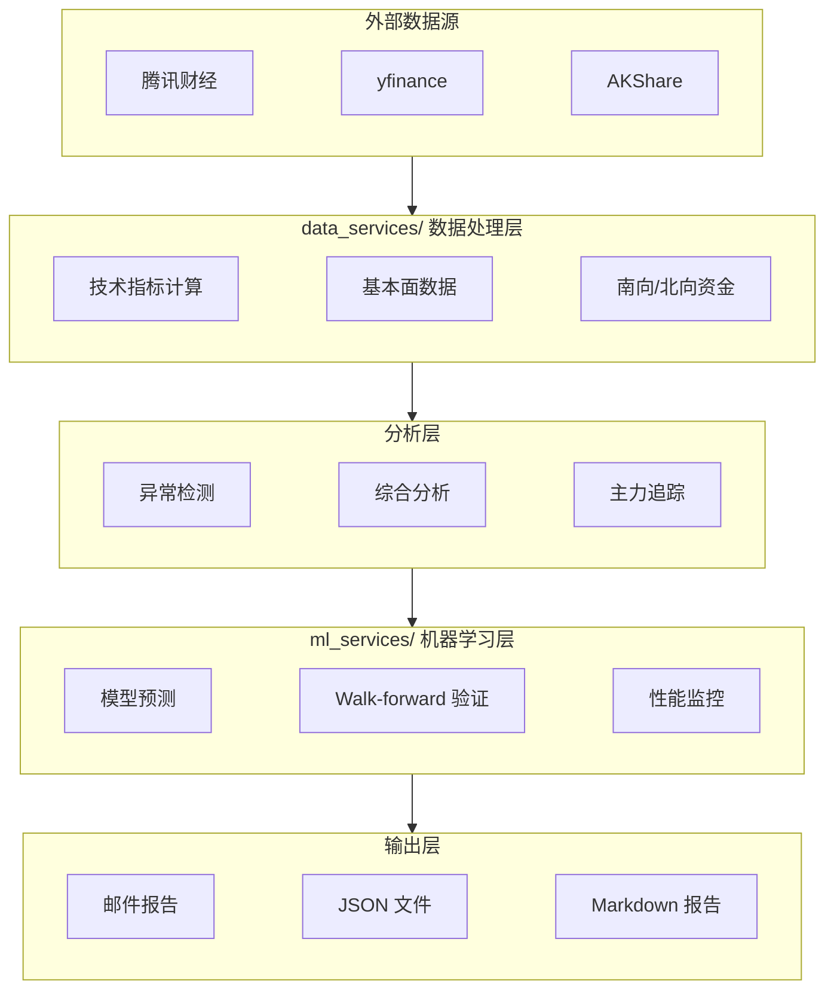
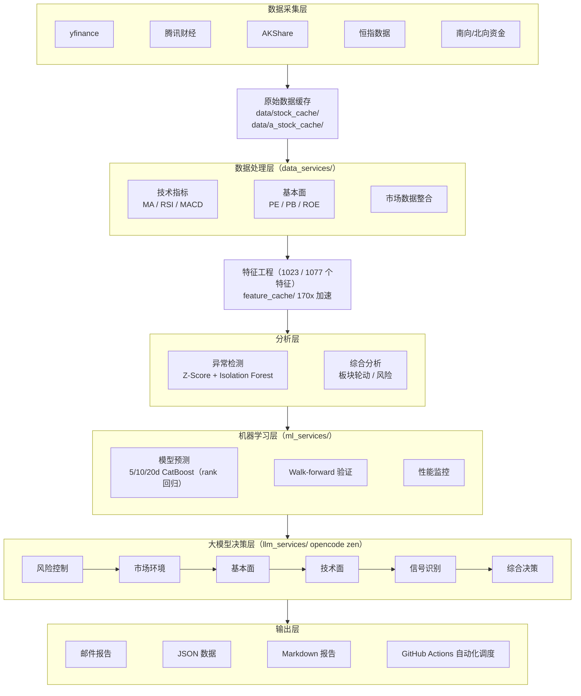
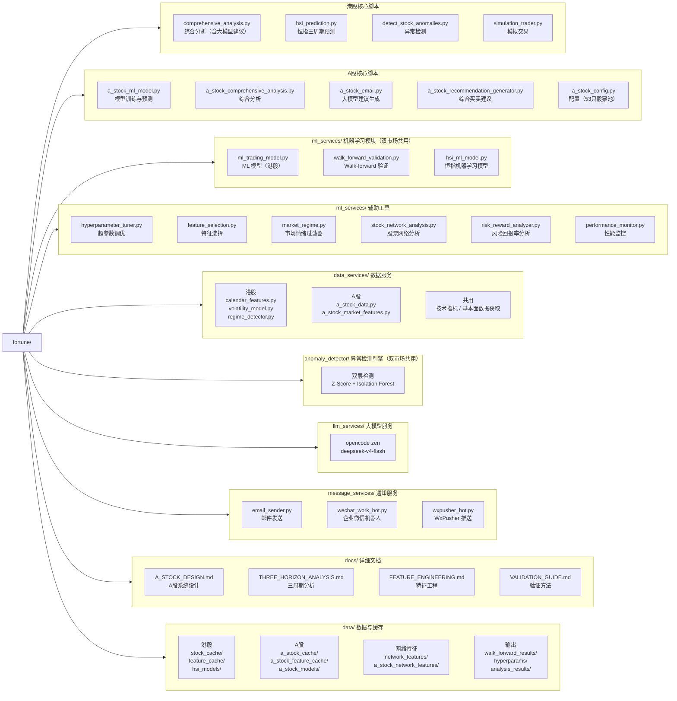

#  金融资产智能分析与交易系统

**⭐ 如果您觉得这个项目有用，请先给项目Star再Fork，以支持项目发展！⭐**

实践**人机混合智能**理念的**金融量化研究框架**：整合**大模型分析**与**机器学习预测**，覆盖**港股 / A股 两大市场**。

> ### ⚠️ 诚实结论（先读这段）
>
> 本项目**不是"能赚钱的策略"**。经严格验证（Walk-forward PIT、三道闸、逐日 mark、静态对照）：
> **"大市方向 / 板块轮动 / 个股差异"三层，及其交叉 / 风格 / 关联题材传播，均已单独测过——未发现可交易 edge**
> （详见 [AGENTS.md](AGENTS.md)「三层总账」与 [docs/DECISIONS.md](docs/DECISIONS.md) D1/D33–D52）。
> ⚠️ **口径 = "未发现（不显著）"，不等同于"已证明没有"**：本宇宙（港股 / ~56 池 / 20d / 净成本）**功效有限（MDE 高）⇒ 不显著 ≠ 没有**（见 [D45](docs/DECISIONS.md) / [D49](docs/DECISIONS.md)）。
> 系统的价值在 **① 工程化  ② 展示 / 报告  ③ 风控 / 研究框架**；其中**最可信的资产是"假设验证框架（尺子 + 技能）"**——
> 它才是本项目"经得起检验"的部分。

### 📌 最新验证状态（2026-10-20）

| 项 | 最新结论 | 出处 |
|---|---|---|
| 个股 rank 三周期（生产口径） | **C 闸全不过**：超额 IR 5d **−0.24** / 10d **−0.49** / 20d **+1.03（95%CI 跨 0）**；DSR 0.700 / 0.989 / 0.917 | [D60](docs/DECISIONS.md) |
| 20d 中性 TopK 低配升配复核 | **不升配**（三周期均未达门槛） | [D61](docs/DECISIONS.md) |
| F1 / HIBOR 特征开关复核 | **维持默认全 ON**；四臂超额 IR 极差 0.78 < MDE 1.59 ⇒ 统计不可区分 | [D62](docs/DECISIONS.md) |
| 异常大跌抄底（补 10d/20d） | 净IR **5d 1.73 / 10d 1.60 / 20d 1.23**（CI>0），但 2025 独大、2024/2026 转负 ⇒ **仅上行期战术** | D59 §十八 |
| 运行态 | 港股日更曾因 LLM 密钥过期（401 `api_key_expired`）失败；**密钥已轮换，待下次 run 验证** | [progress.txt](progress.txt) |

> 结论不变：**alpha null**。以上均为 **Walk-forward 内部比较**，不外推为生产收益。

---

## 🧩 三大功能

| # | 功能 | 是什么 | 诚实定性 |
|---|---|---|---|
| ① | 🇭🇰 **港股预测系统** | 恒指三周期 + 个股预测 + 异常检测 | 能跑的系统；**alpha 未发现**（不显著） |
| ② | 🇨🇳 **A股预测系统** | 三周期 + 综合买卖建议 + 板块分析 | 能跑的系统；**alpha 未发现 + 数据硬顶 640 行 ⇒ 不予升配**（D13） |
| ③ | 🧾 **假设验证框架**（+ 技能 `hypothesis-validation`） | `REVIEW_GATES` / 三道闸 / `strategy_eval` | **项目最可信的资产** |

**外围辅助**（非核心预测）：crypto / 黄金监控、性能监控、新闻抓取、SFC / 南向取数。

**支持市场**：
- 🇭🇰 **港股** - 恒生指数三周期预测、个股预测、异常检测（32只自选股；2026-10-06 剔除 2 只 ETF 后）
- 🇨🇳 **A股** - 三周期预测、综合买卖建议、板块分析（53只股票池）

---

## 📄 效果文档

- 📊 [港股综合分析报告](output/comprehensive_reports) - 每日港股买卖建议
- 📊 [A股综合分析报告](output/comprehensive_reports) - 每日A股买卖建议

---

## 一、核心功能

### 1.1 项目优势

**人机混合**：大模型负责"**理解上下文 / 解释**"，ML 负责"**出数 / 回测**"；两者定位不同、不互相替代。

**工程化验证（本项目核心价值）**：所有信号均经 **Walk-forward（PIT/embargo）+ 三道闸（A 泄漏 / B 过拟合 / C 净IR）+ 折聚类显著性 + 逐日 mark + 静态对照**；评估以 lift / 方向技能 / 超额为准。**至今未发现任何可交易 edge**，负结果已制度化记录（[DECISIONS](docs/DECISIONS.md) D1 / D33–D44）。

**全流程自动化**：从数据采集、特征计算、模型预测到邮件推送，全流程自动化运行。GitHub Actions 定时调度，无需人工干预，确保报告按时产出（不对交易时点作承诺）。

**双市场**：港股（南向资金）/ A股（北向资金、涨跌停）各自优化数据与特征。

**多维度参考**：系统整合三周期预测、异常检测、大模型分析、板块轮动，作**交叉参考**。⚠️ 但**实测未发现这些维度组合能带来可交易 edge**——**勿把"多信号一致"当成"可靠"**（三层总账：大市/板块/个股**皆未发现，不显著**）。

**透明的性能监控**：每日自动评估预测，报告**基准扣除后的诚实指标**（方向技能=准确率−永远看涨、
超额 lift=信号净胜率−无条件买入基准、逐年分解）与 `20d 中性 TopK` 护栏判定，真实反映系统表现。
不隐藏失败预测，持续迭代改进。

### 1.2 双市场概览

| | 🇭🇰 港股 | 🇨🇳 A股 |
|---|---|---|
| 股票池 | 32 只自选股 | 53 只（4 核心 + 49 扩展） |
| 指数预测 | ✅ 恒指三周期 5/10/20d（57.3%/58.5%/52.4%，**折聚类后均不显著**） | ❌ |
| 自动化时间 | 工作日 **16:30 HKT** | 本地 15:15 CST；CI 周日 11:00 |
| 模型准确率 | 20d **52.8%** / 5d 52.4% / 10d 53.4%（**接近随机**） | 方向技能不显著（**640 行硬顶 ⇒ 样本不足**） |

> 模型 / 特征 / 字段细节 → 见 [二、系统构成（简）](#二系统构成简) 与各专项文档。

---

## 二、系统构成（简）

> 港股 / A股 的**详细模型、特征、字段**见各专项文档（见文末「文档」节）。此处只留"**是什么 + 诚实定性**"。

### 2.1 两个市场一览

| | 🇭🇰 港股 | 🇨🇳 A股 |
|---|---|---|
| 预测内容 | 恒指三周期（**5/10/20d**）+ 个股三周期（**5/10/20d**）+ 异常检测（5/10/20d） | 个股三周期（**5/10/20d**）+ 综合买卖建议 + 板块 |
| 市场特有 | 南向资金 | 北向资金、涨跌停特征 |
| 模型 | CatBoost（按周期选型）· Walk-forward（PIT/embargo） | CatBoost · Walk-forward |
| 特征量 | ~1023 | ~1077 |
| 数据硬限 | — | **腾讯源恒返回 640 行（≈2.5 年）⇒ 测试期不足 2 年** |
| **诚实定性** | **alpha 未发现**（不显著；[三层总账](AGENTS.md)） | **alpha 未发现 + 样本不足 ⇒ 不予升配**（[D13](docs/DECISIONS.md)） |

> **标签口径（D59，2026-10-16）**：个股（港股 + A股）标签由「绝对二分类（涨/跌）」改为 **横截面百分位 rank 回归**，周期 `{1,5,20} → {5,10,20}`（**1d 已停用**）；输出语义由「上涨概率」改为「**池内相对强弱分位**」（0–100），展示层不再给「置信度」。**恒指 / 异常检测未变**（非横截面任务）。
> ⚠️ 该改动是**口径 / 架构变更，不是 alpha 提升**——生产口径 C 闸三周期**全部不过**（D60：超额 IR 5d −0.24 / 10d −0.49 / 20d +1.03，20d 的 95%CI 下界 ≤0；DSR 0.700/0.989/0.917）。

### 2.2 双市场共同机制（简）

- **市场情绪过滤器**：按滞后 1 天的上涨比例分层调阈值（extreme_bear<20% 暂停 / bear / weak / normal）；熊市 / 弱震荡用**绝对门槛 0.70 / 0.65**（分位门槛在"模型无 edge"时退化，见 D8）。
- **市场状态稳定性**：HMM `Regime_Duration`（<5 天不稳定 → 降仓；5–15 中等；>15 稳定）。
- **评估口径**：一律**基准扣除后的诚实指标**——方向技能 / 超额 lift / 逐年分解 / **折聚类**显著 / **逐日 mark** / **静态对照**。

### 2.3 其它模块（简）

- **异常检测**：Z-Score + Isolation Forest 双层；"异常 + 当日下跌 → 抄底"（z≤−3，375 信号）净IR **5d 1.73 / 10d 1.60 / 20d 1.23**（CI>0），但**仅限大盘上行期（恒指 > MA200）战术**——逐年 2025 独大、2024/2026 转负，**非稳健 edge**（2026-10-20 重跑）。
- **大模型分析**：经 OpenAI 兼容端点（opencode zen，`deepseek-v4-flash`）做"**解释 / 上下文**"，**不作 alpha**；长 prompt 需 `x-opencode-session` 头（见 [DECISIONS](docs/DECISIONS.md)）。
- **风险回报 / 模拟交易**：辅助工具（仓位 / 止损 / 日志），**非预测信号**。

> ⚠️ 以上所有"预测 / 信号"经严格验证**均未发现可交易 edge**——请按"**研究 / 展示 / 风控**"使用，**勿当买卖依据**。

## 三、快速开始

```bash
# ============ 🇭🇰 港股系统 ============
# 恒生指数预测
python3 hsi_prediction.py --no-email

# 综合分析（含三周期预测和风险回报率分析）
./scripts/run_comprehensive_analysis.sh

# 港股异常检测
python3 detect_stock_anomalies.py --mode standalone --mode-type deep

# 模型训练
python3 ml_services/ml_trading_model.py --mode train --horizon 20 --model-type catboost

# Walk-forward验证（成功后自动入库 CSV+快照，--no-commit 关闭）
python3 ml_services/walk_forward_validation.py --model-type catboost --horizon 20

# 风险回报率分析
python3 ml_services/risk_reward_analyzer.py --stocks watchlist --style moderate

# ============ 🇨🇳 A股系统 ============
# A股完整分析流程（训练→预测→大模型建议→综合分析）
./scripts/run_a_stock_analysis.sh

# A股模型训练
python3 a_stock_ml_model.py --mode train --horizon 20

# A股模型预测（仅核心股）
python3 a_stock_ml_model.py --mode predict --horizon 20 --core-only

# A股Walk-forward验证
python3 a_stock_walk_forward.py --horizon 20

# ============ 缓存管理 ============
# 清除港股特征缓存
rm -rf data/feature_cache/*.pkl

# 清除A股特征缓存
rm -rf data/a_stock_feature_cache/*.pkl

# 清除原始数据缓存
rm -rf data/stock_cache/*.pkl data/a_stock_cache/*.pkl
```

---

## 四、技术架构

### 9.1 数据流架构



**关键依赖关系**：

| 模块 | 港股 | A股 |
|------|------|-----|
| 数据获取 | yfinance + 腾讯财经 | AKShare + 腾讯财经 |
| 市场资金 | 南向资金 | 北向资金 |
| 价格限制 | 无涨跌停 | 主板10% / 创业板20% |
| 核心模型 | `ml_trading_model.py` | `a_stock_ml_model.py` |
| 综合分析 | `comprehensive_analysis.py` | `a_stock_comprehensive_analysis.py` |
| 大模型建议 | `comprehensive_analysis.py` 集成 | `a_stock_email.py` |
| 运行时间 | 16:30 HKT | 15:15 CST |

### 9.2 数据流图



**缓存机制**：

| 市场 | 缓存类型 | 位置 | 有效期 | 加速效果 |
|------|---------|------|--------|---------|
| 🇭🇰 港股 | 原始数据 | `data/stock_cache/` | 7天 | - |
| 🇭🇰 港股 | 特征缓存 | `data/feature_cache/` | 7天 | **170x** |
| 🇨🇳 A股 | 原始数据 | `data/a_stock_cache/` | 7天 | - |
| 🇨🇳 A股 | 特征缓存 | `data/a_stock_feature_cache/` | 7天 | **170x** |

---

## 五、项目结构



---

## 六、自动化调度

| 时间 | 工作流 | 功能 | 市场 |
|------|--------|------|------|
| **06:00** (工作日) | `hsi-prediction.yml` | 恒生指数预测 | 🇭🇰 |
| **06:00** (工作日) | `batch-stock-news-fetcher.yml` | 批量个股新闻抓取 | 🇭🇰 |
| 每小时 | `hourly-crypto-monitor.yml` | 加密货币监控 | 🌐 |
| 每小时 | `hourly-gold-monitor.yml` | 黄金监控 | 🌐 |
| **16:30 HKT** (工作日) | `comprehensive-analysis.yml` | 港股综合分析 | 🇭🇰 |
| **00:00 HKT** (工作日) | `performance-monitor.yml` | 性能报告（仅港股，含 lift/方向技能/护栏状态） | 🇭🇰 |
| 周日 09:00 HKT | `weekly-comprehensive-analysis.yml` | 港股周度综合分析 | 🇭🇰 |
| 周日 11:00 CST | `weekly-a-stock-comprehensive-analysis.yml` | A股周度综合分析 | 🇨🇳 |
| 周一 08:00 HKT | `test-llm-api.yml` | LLM API 连通性测试 | - |

> 说明：`performance-monitor.yml` 报告**带基准扣除的诚实指标**与护栏状态；严格护栏
> （`monthly_guardrail.py`，需本地 `prediction_analysis.csv`）在**本地每月**执行，见
> [docs/DEPLOYMENT.md](docs/DEPLOYMENT.md)。

### 命令汇总

```bash
# ============ 🇭🇰 港股核心 ============
python3 hsi_prediction.py --no-email                        # 恒指预测
python3 comprehensive_analysis.py                            # 综合分析
python3 detect_stock_anomalies.py --mode standalone         # 异常检测
python3 simulation_trader.py                                 # 模拟交易
python3 ml_services/ml_trading_model.py --mode train --horizon 20 --model-type catboost  # 模型训练
python3 ml_services/walk_forward_validation.py --model-type catboost --horizon 20        # Walk-forward
python3 ml_services/risk_reward_analyzer.py --stocks watchlist --style moderate          # 风险分析

# ============ 🇨🇳 A股核心 ============
./scripts/run_a_stock_analysis.sh                            # 完整流程
python3 a_stock_ml_model.py --mode train --horizon 20       # 模型训练
python3 a_stock_ml_model.py --mode predict --horizon 20 --core-only  # 模型预测
python3 a_stock_walk_forward.py --horizon 20                # Walk-forward

# ============ 共用工具 ============
python3 ml_services/performance_monitor.py --mode all --no-email
python3 ml_services/hyperparameter_tuner.py --horizon 20 --n-iter 30
python3 ml_services/stock_network_analysis.py --skip-pmfg

# ============ 缓存清理 ============
rm -rf data/feature_cache/*.pkl                              # 港股特征缓存
rm -rf data/a_stock_feature_cache/*.pkl                      # A股特征缓存
rm -rf data/stock_cache/*.pkl                                # 港股原始数据
rm -rf data/a_stock_cache/*.pkl                              # A股原始数据
```

---

## 七、安装部署

```bash
# 1. 克隆项目
git clone https://github.com/wonglaitung/fortune.git
cd fortune

# 2. 安装依赖
pip install -r requirements.txt

# 3. 配置环境变量
cp set_key.sh.sample set_key.sh
# 编辑 set_key.sh，填写邮箱和API密钥
source set_key.sh

# 4. 验证安装
python hsi_email.py --no-email
```

**必填环境变量**：

| 变量名 | 说明 |
|--------|------|
| `SMTP_SERVER` | SMTP服务器地址 |
| `EMAIL_SENDER` | 发件人邮箱 |
| `EMAIL_PASSWORD` | 邮箱授权码 |
| `RECIPIENT_EMAIL` | 收件人邮箱 |
| `QWEN_API_KEY` | LLM 密钥（opencode zen；配合 `QWEN_CHAT_URL` / `QWEN_CHAT_MODEL`） |

---

## 八、核心警告

| 警告 | 说明 |
|------|------|
| **数据泄漏** | Walk-forward 准确率 >65%（个股/A股）或 >80%（恒指）通常有数据泄漏 |
| **预测阈值** | 方向判断用 **0.5**，不是 0.65 |
| ~~CatBoost 1天模型~~ | ❌ **已停用（D59 重写）**：周期改为 5/10/20，1d 不再生产 |
| **深度学习** | LSTM/Transformer F1≈0，不推荐 |
| **加密货币** | 股票策略不适用 |
| **恒指 vs 个股** | 恒指 5/10/20d 57.3%/58.5%/52.4%（折聚类后均不显著）vs 个股 20d 52.8%（rank 口径；超额 IR 0 附近，不显著）；三周期八大模式折聚类后均不显著，**均不可交易** |
| **高置信度风险** | 高置信度预测错误时损失可达 -73%，必须设置止损 |
| **时点口径** | 全链路统一 `mode='production'`（**T 收盘**，T+1 成交）；WF 与生产同一 mode，不再有 T-1/T 双口径（D25） |
| **特征缓存版本** | 缓存失效时需清除（`rm -rf data/*feature_cache/*.pkl`） |
| **分类特征 NaN** | CatBoost 训练和预测时需一致处理分类特征 NaN |
| **A股涨跌停差异** | 主板10%涨跌停，创业板20%涨跌停，混合训练需标签标准化 |
| **A股股票代码** | 保存CSV时必须用字符串格式 `zfill(6)`，否则前导零丢失 |
| **A股样本权重** | 核心股权重3.0倍，扩展股1.0倍，训练时需传入 |
| **A股数据泄漏阈值** | 个股准确率正常范围50-60%，>65%为数据泄漏信号 |
| **IC 不等于收益** | IC 高不代表收益高，需结合损失分布分析 |
| **绝对值特征** | 跨股票训练时，绝对价格/成交量特征必须标准化或排除 |

---

## 九、文档

- **[AGENTS.md](AGENTS.md)** - 快速参考指南
- **[lessons.md](lessons.md)** - 经验教训
- **[progress.txt](progress.txt)** - 项目进展
- **[docs/](docs/)** - 详细文档
  - [README.md](docs/README.md) - 文档索引（该看哪份）⭐
  - [QUANT_SYSTEM_METHODOLOGY.md](docs/QUANT_SYSTEM_METHODOLOGY.md) - **量化系统建设方法论** ⭐
    回答"一个量化系统该怎么从零建、已有的该怎么补"这一方法级问题（区别于 DECISIONS 的项目级结论，方法长期有效）。主线内容：
    - **五层结构**（数据 → 信号 → 统计 → 组合 → 决策），每层有自己的反模式与失效方式
    - **七条元原则**：基准比模型更难定义、从决策倒推证据链、n_eff 先行、负结果制度化、口径即宪法、统计过关 ≠ 可交易、结论必须条件化
    - **七阶段建设步骤**：立规矩 → 立时点 → 最小验证器 → 组合闸门 → 流程自动化 → 防腐 → 才开始建模型（每阶段含做什么 / 验收 DoD / 跳步代价 / **本项目怎么做**）
    - **三道闸门**（是不是假的 → 是不是真的 → 值多少）、假设生命周期、反模式清单、上线前自检、人机边界
    - 文首有"一分钟看懂"与按身份分流的三条阅读路径；文末附 **37 条术语表**（正文术语均带跳转链接）与一句话速查
  - [A_STOCK_DESIGN.md](docs/A_STOCK_DESIGN.md) - A股系统设计
  - [THREE_HORIZON_ANALYSIS.md](docs/THREE_HORIZON_ANALYSIS.md) - 三周期分析
  - [FEATURE_ENGINEERING.md](docs/FEATURE_ENGINEERING.md) - 特征工程
  - [FEATURE_IMPORTANCE_ANALYSIS.md](docs/FEATURE_IMPORTANCE_ANALYSIS.md) - 特征重要性分析
  - [VALIDATION_GUIDE.md](docs/VALIDATION_GUIDE.md) - 验证方法
  - [量化交易误解-正式文档.md](docs/量化交易误解-正式文档.md) - 量化交易常见误区（方法论注脚）
  - [SECTOR_ROTATION_TRADING_RULES.md](docs/SECTOR_ROTATION_TRADING_RULES.md) - 板块轮动
  - [BANK_AND_ETF_TRADING_GUIDE.md](docs/BANK_AND_ETF_TRADING_GUIDE.md) - 银行股与盈富基金买卖指引
  - [programmer_skill.md](docs/programmer_skill.md) - 开发规范

---

## 十、依赖项

`yfinance` `catboost` `akshare` `pandas` `scikit-learn` `lightgbm` `jieba` `hmmlearn` `arch` `networkx`

---

## 十一、许可证

MIT License

---

## 十二、联系方式

- Issues: https://github.com/wonglaitung/fortune/issues
- Email: wonglaitung@gmail.com

---

## 十三、Star History

